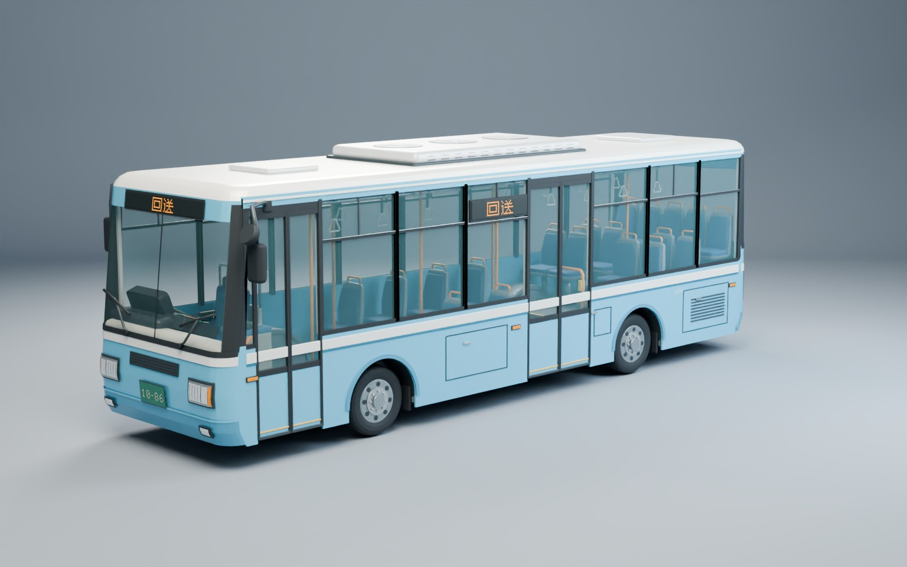
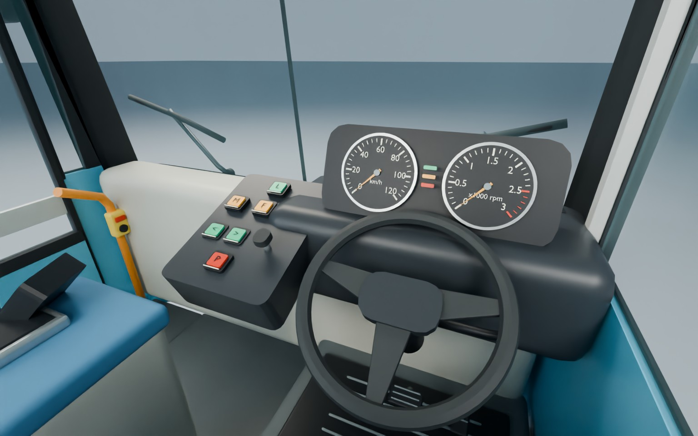
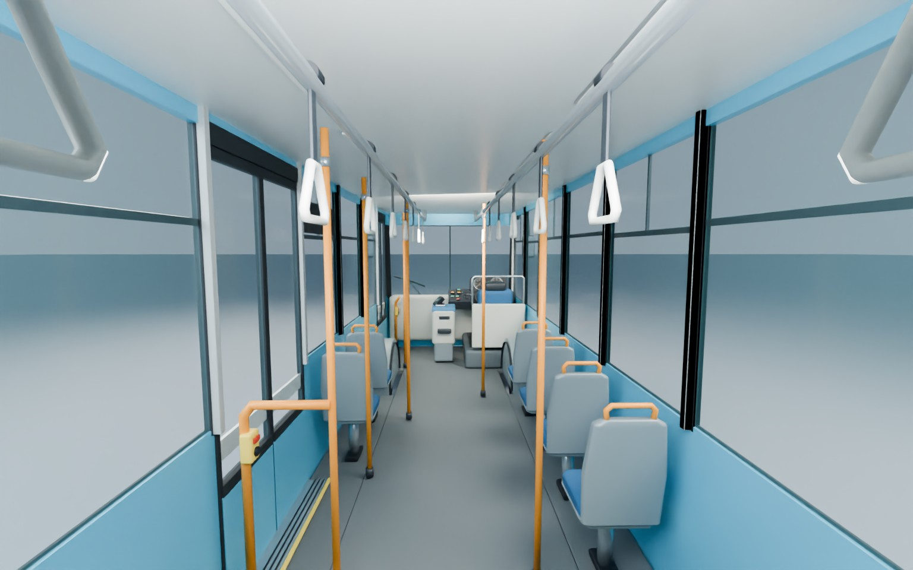

# 高松210あ1086のモデル

[編集用の Blender ファイル](Bus1086.blend) は、窓・外板・運転台・客席など939個のメッシュを2つのコレクションに分けて収録している。Blender 4.3.2 で保存・再読込を確認した。[UE用FBX](Bus1086.fbx) は同じ形状を23本の骨ごとにまとめたもの。[材質・ボーン原点の一覧](Bus1086.json) をFBXと一緒に使う。UEエディターへの導入は [Windowsでの設定手順](../../docs/1086-UE-SETUP.md) を参照。

| 外観 | 運転席 | 客室 |
| --- | --- | --- |
|  |  |  |

前面と側面のガラスを通して車内が見える。曲面を持つ前面、前・側・後面の「回送」LED、前後の「10-86」プレート、乗降口、右側の運転台とペダル、ATセレクター、運賃箱、座席、つり革は独自の形状と43種類の材質で制作した。写真テクスチャや外部の車両素材は使用していない。対象車と制作上の仮定は [実車資料と再現範囲](../../docs/1086-REFERENCES.md) を参照。

## Blenderで編集する

**File → Open** で `Bus1086.blend` を開く。外装は **Exterior**、客室と運転台は **Passenger saloon and driving position** コレクションにある。材質の色や透過を見るにはビューポート右上で **Material Preview** を選ぶ。

- Blenderでは前方が +X、左が +Y、上が +Z、1単位は1 m。地面上の前後車軸の中点が原点。UEでは前方が +X、右が +Y、1単位は1 cm。ミラー・突起を含むモデルを再計測した全長・全幅・全高は約9.051 × 2.989 × 3.066 m。左右の車輪中心間は1.88 m、軸距は4.40 m。
- 各メッシュの全頂点に、対応する骨1本のウェイトを1.0で設定した。`wheel_FL/FR/RL/RR` は直進時の車輪中心。2枚ずつの前扉・中扉、ハンドル、針、ペダル、各スイッチ、ワイパーは個別にポーズを付けられる。前扉は縦の回転軸、中扉はスライドで開く設定。
- 動きを見るには、Outlinerから **Armature** を選び、ビューポート左上の **Object Mode → Pose Mode** に切り替える。骨を選べるように右上の **Overlays** を有効にする。Armature の **Object Properties → Viewport Display → In Front** を有効にすると車体越しに選べる。`door_front_A` を選び **R → Z → 45 → Enter**、**Alt+R** で元に戻す。
- Blender原本は部品別に編集できる。手編集したファイルは別名保存する。下のコマンドはPythonで形状を作り直すので、手編集をUEにも反映したい場合は該当部品の生成コードに反映してから再生成する。

## 3Dファイルを再生成・検査する

Blender 4.3.2 を使い、リポジトリのルートから実行する。以下は Windows PowerShell の例。バージョンによってはBlender本体のパスを変更する。出力先に同名ファイルがあると再生成で上書きする。

```powershell
$blender = 'C:\Program Files\Blender Foundation\Blender 4.3\blender.exe'
& $blender -b --python-exit-code 1 -P Art/Bus1086/build_bus.py -- Saved/1086Model
& $blender -b --python-exit-code 1 -P Art/Bus1086/verify_bus.py -- Saved/1086Model
& $blender -b Saved/1086Model/Bus1086.blend --python-exit-code 1 -P Art/Bus1086/render_preview.py -- --out-dir Saved/1086Preview
```

`exterior.py` が車体・台枠・ミラー・外装灯・扉・車輪を、`interior.py` が運転台・操作機器・客室を作る。`build_bus.py` が両方をバインドする。FBXはセンチメートル単位の骨格、三角形化、材質名、投影UVを持つ。UVは単色材用で、塗装テクスチャ用の展開図は未作成。元の部品の編集・作り直しにはBlender原本または生成スクリプトを使う。

検査は原本を開き、続いて空のシーンにFBXを再インポートする。**PASS Blender source** と **PASS FBX round trip** の両方を確認する。同梱版はどちらも141,718三角形で一致した。車輪半径、接地位置、ホイールハウスに遮られないこと、各頂点のウェイト、材質名、FBXのUV、前扉だけが動くことを検査する。UEでのボーン座標の検査は [インポートスクリプト](../../scripts/import_kotoden1086.py) 実行時に別途行う。

同梱プレビューはBlenderのCyclesレンダリング。照明とカメラはレンダリング時に作成する。UEでのガラス、ランプ、コリジョン、計器、乗り心地は [試走手順](../../docs/1086-DRIVING.md) で確認する。
