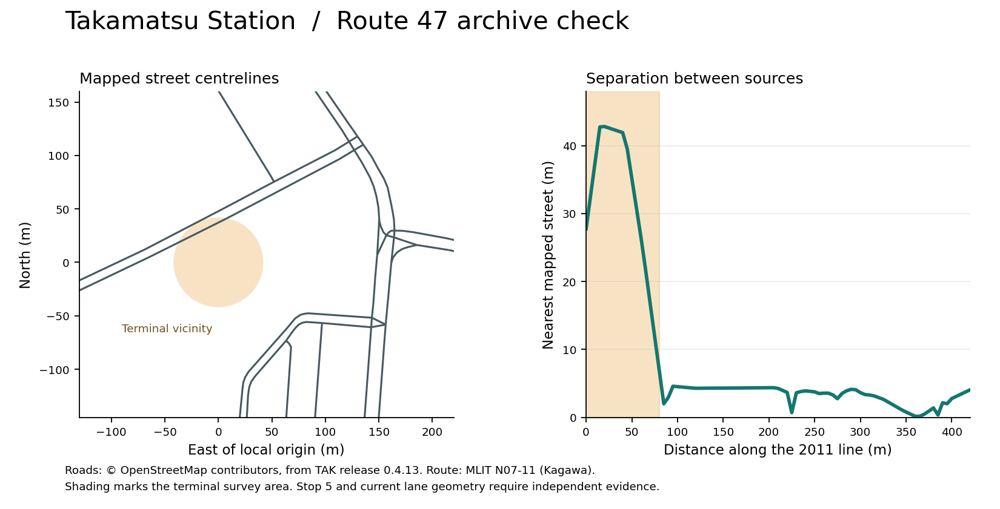

# 高松駅⑤番のりばと御厩線47番

対象は高松駅の出発位置から最初の停留所まで（上限550 m）。駅前広場と公道への接続を一緒に扱う。取得時の下り便から区間と進行方向を決め、道路、縁石、建物、信号を同じ座標に投影する。

## 出典と精度

| 資料 | 使用範囲・限界 |
|---|---|
| [ことでんバス・御厩線](https://www.kotoden.co.jp/publichtm/bus/rosen/yusa_mimaya/index.html)、[事業者のGTFS公開ページ](https://www.kotoden.co.jp/publichtm/gtfs/index.html) | 47番、高松駅⑤番はプロジェクト指定と既調査記録による。インストール時にバス用GTFSの運行日・方面・停留所順・位置・経路形状を照合する。乗場の緯度経度と車体中心を区別する。利用は個人のローカル環境。原本・写真・時刻表の再配布を行わない。公開条件は配布元を参照。 |
| [国土数値情報の旧バスルートをGeoJSON化した資料](https://github.com/handygeospatial/ksj/blob/f1815c26a92cb1efdb66419e331a329c87f93ea9/N07/N07-11_37.geojson) | 2011年香川県の「ことでんバス（株）／御厩・県立プール線47」は、駅前を回り東寄りの道路へ出て南下する線形を持つ。2026-11-23に属性・線形を閲覧。現行の出口・車線・停車位置を確定するための資料には使わない。 |
| [国土数値情報・バス停留所2022年の加工表](https://github.com/tomtkg/Japanese-Bus-Stop-Data/blob/c4741e649c979b52a507fd695756fcac1373422c/prefectures/37_Kagawa.csv) | 高松駅、高松築港に御厩線の記載を確認。表に停留所の順序や車線座標は含まれない。 |
| [OpenStreetMap contributors](https://www.openstreetmap.org/copyright) | 道路・一方通行・道路幅/車線数・歩道・プラットフォーム・交差点・横断歩道・信号ノード・建物輪郭。ODbL 1.0。データは取得時の地図であり現地測量ではない。元のOSM IDと利用した属性を記録。派生データを外部配布する場合はODbLの帰属・データ提供条件を確認する。 |
| [PLATEAU高松市2022年](https://www.geospatial.jp/ckan/dataset/plateau-37201-takamatsu-shi-2022)、[公開モデルの利用条件](https://www.mlit.go.jp/plateau/open-data/) | 建築物LOD1の地表輪郭・高さを優先するための資料。年度・範囲は運行経路と別。利用時は個別データの出典と許諾を記録する。テクスチャ・航空写真は使用しない。 |
| [地理院タイル一覧・標高](https://maps.gsi.go.jp/development/ichiran.html#dem)、[国土地理院コンテンツ利用規約](https://www.gsi.go.jp/kikakuchousei/kikakuchousei40182.html) | 10 mメッシュ標高を地域の起伏に用いる。格子からの補間値で、バスベイの縁石高や舗装面の測量値ではない。 |

原点は東経134.0474°、北緯34.3517°の計算上の基準点。WGS84楕円体から局所接平面に投影し、UEではXが北、Yが東、Zが上、1 m = 100 cm。公開元が到達不能なクラウドでは、現行GTFS・OSM・標高の取得に成功したとは扱わない。出典や精度は生成時の記録と合わせて確認する。

## 実際に照合できた区間

2011年の47系統の出発点から420 mを5 mごとにサンプルし、2026年公開のOSM由来道路中心線99地物との平面距離を計算した。0〜80 mの17点では中央値35.2 m、最大42.8 m。90〜420 mの67点では中央値3.7 m、最大4.6 m。前半では道路抽出にターミナル内通路が不足している可能性があり、道路が移設されたとは断定できない。後半330 mはクラウドで実際に道路メッシュ生成器に通し、照合窓全体で車道1,726三角形を生成した。この検査の車道幅は6 mの仮値。旧経路と現行道路との比較やUE実走は別に確認する。



検査用の道路はTAK 0.4.13の `roads.geojson` のみを読み込んだ。道路の出典は © OpenStreetMap contributors、配布リポジトリのライセンス表記はGPL-3.0。図は独立した検図用画像。Windows導入ツールはこのアーカイブや図をゲーム素材に使わず、OSMの元データを取得する。[TAKの配布元・データ内訳](https://github.com/ahkimn/subwaybuilder-jp-maps) ｜ [0.4.13リリース](https://github.com/ahkimn/subwaybuilder-jp-maps/releases/tag/0.4.13) ｜ [OSMの帰属と条件](https://www.openstreetmap.org/copyright)

再計算には、冒頭のリンクにあるN07-11_37.geojson（SHA-256 `2c8d37247aaf71545e416beb320cf363abbd1ffadf266c830982959a88bf6dd1`）とTAK.zip（`85d812abd4144b40635ac5ab1abd744f1b944db9c66c3e316e847ea1c1ce2c98`）を使用する。Shapely 2.1.2を用意し、次を実行する。図を再作成する場合だけMatplotlibと `--figure archive-check.png` が必要。

```shell
python Maps/TakamatsuStage1/compare_archive.py N07-11_37.geojson TAK.zip --exercise
```

## Windowsで生成される地図

| 地物 | 元データから決まるもの | 暫定値・欠測時の扱い |
|---|---|---|
| 発進位置と経路 | 日本時間の運行日、47番または番号なしの御厩線、起点・次停留所、GTFS shapes。形状がない場合はOSMの順序付きバス路線も照合 | 停留所座標から左側通行・一方通行・車体外周を満たす車道位置を探索。停止線の実測値はない。乗場番号の根拠がなければ駅名だけを表示。経路線が取得できず、⑤の位置と一方通行だけが確かな場合は発進のみの検証として記録 |
| 車道・交差点・区画線 | OSM道路中心線、面、分離帯、交差点での道路接続、地上層、タグの幅と車線数 | 幅がない場合は車線数×3.1 m、両方ない場合は道路種別の幅。車道面を結合し交通島を除く。車線数が明示された道に推定区画線を描く。破線の種別・ピッチや交差点の隅切りは現地照合待ち |
| 歩道・縁石・信号 | 歩道・島の面または線、歩道の左右属性、横断歩道・信号の記録位置 | 歩道高0.14 m、縁石上面0.155 m。信号機の向き・筐体寸法・路端のポールは仮定。灯色制御は未実装 |
| ターミナル・建物 | プラットフォーム輪郭、OSMで確認できる上屋。PLATEAUの地表輪郭と高さを優先し、残りをOSM建物輪郭で補完 | 上屋下4.2 m。建物高さの優先順はPLATEAU、OSMのheight、階数×3.2 m、8 m。ファサードや屋根詳細、測量済みのバスベイ形状は未収録 |
| 地形 | 国土地理院10 mメッシュ標高タイルを補間し、原点標高を引く。路面・地面を15 m格子で分割 | 近傍で埋めた欠測を記録。標高に広い欠測がある場合は全域を平坦として記録する |

`survey.json` の `stops`・`path_source`・`platform_evidence` で選択根拠、`features` で地物IDと寸法の出所、`sources` で参照URLとファイルハッシュを確認できる。次停留所までの距離が長ければ550 mまたは取得範囲の境界で打ち切る。1 m間隔の `swept_path` は資料の経路線に前軸を置き、仮の軸距4.4 m・車体9.0×2.32 mで後軸と車体を追従させた机上検査。ミラーの張り出し、実際のハンドル操作、隣接車線の利用は実走で確認する。位置ずれを隠す目的で車道を広げる処理はない。

配布元が応答した場合だけ、PLATEAUのCKAN配布情報・許諾を確認し、CityGMLのZIPをHTTP Rangeで対象メッシュ分だけ取得する。対象タイル・LODを取得できなければOSMへ切り替え、警告を保存する。手動入力は `Saved/TakamatsuStage1/Inputs` の `gtfs_kb.zip`、`station.osm`、高松市2022年の建築物 `*.gml`（CityGML 2.0 / EPSG:6697）、`dem-X-Y.txt`。OSM範囲は西134.0442、南34.3486、東134.0508、北34.3540。変更した原本を使うときは元の出典と調整内容を別途保管する。[バスGTFS](https://www.kotoden.co.jp/publichtm/gtfs/gtfsdata/latest/gtfs_kb.zip) ｜ [対象範囲のOSM XML](https://api.openstreetmap.org/api/0.6/map?bbox=134.0442,34.3486,134.0508,34.3540)

Windowsの変換用依存はNumPy 1.26.4（BSD-3-Clause）、Shapely 2.1.2（BSD-3-Clause、車輪パッケージに含まれるGEOSはLGPL）。UE付属Python 3.11用のWin64 wheelをハッシュ検証し、プロジェクトのSaved内に展開する。[NumPy](https://numpy.org/doc/stable/license.html) ｜ [Shapely](https://github.com/shapely/shapely/blob/2.1.2/LICENSE.txt) ｜ [GEOS](https://libgeos.org/)
