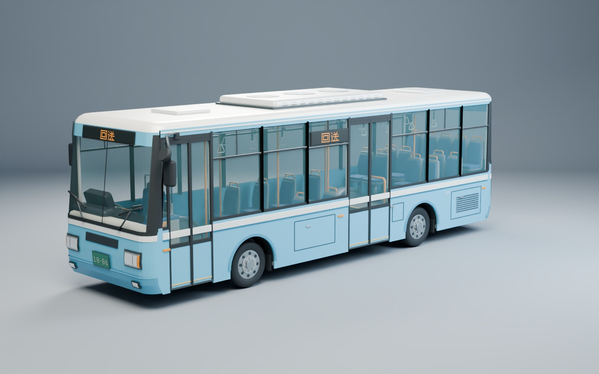

# Kotoden Bus Simulator（個人開発）

日本の路線バスの運転と業務を再現する、Windows向け3Dバスシミュレーターのプロジェクト。

**最終目標:** ことでんバスをモデルに、高松駅発の御厩線を実在道路に近い高松市の3Dマップ上で運転する。

## 高松駅・御厩線47番のマップを開く

UEを閉じ、GitHub Desktopで `feature/takamatsu-map-stage1` をPullし、`scripts/INSTALL_TAKAMATSU_STAGE1.cmd` をダブルクリックする。導入済みの1086号車を使用し、駅前のデータから新しいレベルを生成する。Windowsでのビルドと走行は検証待ち。[導入・試走・失敗時の確認方法](docs/TAKAMATSU-MAP-STAGE1.md#windowsでの導入と実走確認)

## 1086号車を更新して運転する

UEを終了し、GitHub Desktopで `feature/1086-mt-driving` を取得して **scripts/UPGRADE_KOTODEN1086.cmd** をダブルクリックする。バックアップとビルドが終わったら、開いた試走場で **Play**。起動時は6速AT。停車・駐車ブレーキONで **T** を押すと、同じ1086号車の完全MTと自動クラッチMTを選べる。MTはゲーム独自の訓練装備。[発進・再始動・記録・AT回帰の手順](docs/1086-MT.md)

## 高松210あ1086を開く

現在の対象は2024年導入の日野レインボー（2KG-KR290J5、6速AT）。水色の車体、前・中扉、右ハンドルの運転席、客席を持つ独自モデルを収録した。

- **車体を見たい場合**　Blenderで [Bus1086.blend](Art/Bus1086/Bus1086.blend) を開く。[運転席](Art/Bus1086/preview/cockpit.jpg) と [客室](Art/Bus1086/preview/cabin.jpg) のレンダリング、[モデルの構造と再生成手順](Art/Bus1086/README.md) も参照できる。
- **Windowsで運転する場合**　UE 5.5.4、VS 2022、F310のXInputモードを使用する。[初回ビルド・自動インポート・試走レベルの作成](docs/1086-UE-SETUP.md) を行い、[発進操作と車両設定](docs/1086-DRIVING.md) に進む。付属FBXを使えるためBlenderのインストールは任意。
- **検証状況**　Blenderでモデルを生成し、外観・内装をレンダリングした。従来の1086号車はユーザーのWindows UE5.5.4＋F310で基本走行・各種操作を確認済み。Issue #8の変更後のビルド・AT回帰・MT走行・音・720p性能は実機確認待ち。実車と照合できていない外形・塗装・運転台配置・走行定数は [実車資料と推定の記録](docs/1086-REFERENCES.md) に記載した。

以下のP0技術検証は既存の試験車とローカルレベルで引き続き利用できる。

## 開発環境

- Unreal Engine 5（まずUE 5.5.4を試す。正式確定は実機検証後）
- Windows PC（Core i5-12400、RTX 3060、RAM 16 GB）
- C++ / Blueprint / Visual Studio 2022 Community / Blender / Codex
- 1280×720、60fps目標（未計測）

## Windows でエディターを開く（P0）

1. Epic Games Launcher で Unreal Engine 5.5.4 をインストールし、パッチバージョンを確認する。`.uproject` の `EngineAssociation` は Launcher の登録名 `5.5` を指定するため、この値だけでは 5.5.4 に固定されない。
2. Visual Studio Installer で Visual Studio 2022 Community（17.8 以降、17.10 推奨）に「C++ によるゲーム開発」ワークロード、MSVC v143 x64/x86 ビルドツール、Windows 10/11 SDK を入れる。対応するツールチェーンは [Epic の Visual Studio セットアップ手順（UE 5.5）](https://dev.epicgames.com/documentation/en-us/unreal-engine/setting-up-visual-studio-development-environment-for-cplusplus-projects-in-unreal-engine?application_version=5.5) を参照。
3. このブランチをチェックアウトし、リポジトリ直下の `KotodenBusSimulator.uproject` を右クリックして「Generate Visual Studio project files」を選ぶ（Windows 11 では「その他のオプションを表示」の中にある場合がある）。別のエンジンが選ばれている場合は「Switch Unreal Engine version」で、インストールした 5.5.4 を選ぶ。
4. 生成された `KotodenBusSimulator.sln` を Visual Studio で開き、`Development Editor` / `Win64` を選択して `KotodenBusSimulator` プロジェクトをビルドする。ビルドが成功したら `KotodenBusSimulator.uproject` をダブルクリックしてエディターを起動する。
5. エンジン付属の空マップ `Entry` が開くことと、「Edit → Plugins」で Chaos Vehicles と Enhanced Input が有効になっていることを確認する。必要に応じて「Play」で空マップの実行開始・停止を確認する。

P0 の走行・入力には UE 5.5.4 に同梱の Chaos Vehicles と Enhanced Input を使用する。P0-3 の走行確認には同梱の Vehicle テンプレートから車両アセットを取り込む。UE の利用条件が適用され、有料アセットは不要。

**P0-1 の検証状況:** ユーザーの Windows 環境（UE 5.5.4、Visual Studio 2022）で C++ ビルドとエディター起動に成功。

## P0-2: F310の入力を画面に表示する

作業ブランチは `p0/f310-input-diagnostics`。

1. UE5 を終了してから Visual Studio 2022 で `Development Editor` / `Win64` を選び、ビルドする。
2. `KotodenBusSimulator.uproject` を開き、`Entry` マップで **Play** を押す。
3. プレイ画面をクリックし、XInputモードのF310を動かす。
4. Cyan（シアン色）のデバッグ表示でRT/LT、左・右スティック、A/LB/RBを確認する。

既定の構成では Blueprint アセットの設定は不要。GameMode が入力用 Controller と診断用 HUD を選び、Controller が Enhanced Input アクションとマッピングを生成する。
**P0-2 はユーザーの Windows 実機で F310 の全入力を確認済み**。詳細は [F310入力テスト手順](docs/P0-2-F310-TEST.md) を参照。

## P0-3: Chaos 仮車両の走行

UE 5.5.4 の Vehicle テンプレートから仮車両のアセットを移行し、車両 Blueprint と平坦な走行レベルを作る。C++ 側は P0-2 の入力を再利用し、RT・左スティック X・A を Chaos に渡す。追従カメラと、車速・連続ブレーキ指令の表示を追加した。

最初に [Windows でのアセット設定と走行確認](docs/P0-3-CHAOS-DRIVE.md) を参照。P0-3 はユーザーの Windows（UE 5.5.4）で F310 による発進・旋回・停止を確認済み。

## P0-4: 独自クラッチと Chaos の接続調査

車輪への外部トルク入力と標準駆動系の調査結果は [技術メモ](docs/P0-4-CHAOS-CLUTCH.md) を参照。ユーザーの UE 5.5.4 で API と `Override` の挙動をソース確認済み。

P0-4B では試作用 `BusClutchPrototypeVehiclePawn` を追加した。通常の P0-3 車両と切り替える方法、仮値、確認項目は [独自クラッチ走行試作の手順](docs/P0-4B-CLUTCH-DRIVE.md) を参照。P0-4B は **ビルド未実施 / UE実行未確認 / F310実機未検証**。

## C++ と Blueprint の構成

`Source/KotodenBusSimulator/` はゲーム用の Runtime モジュール。実装は `Private/` に置き、新しい型を他モジュールに公開する必要ができた時点で `Public/` を使う。UE API の入口は Chaos Vehicles の `UChaosWheeledVehicleMovementComponent` と、Enhanced Input の `UEnhancedPlayerInput` / `UEnhancedInputComponent` を想定する。P0-2 の入力状態は `GetDriverInputState()` で C++ と Blueprint から参照できる。診断用 HUD はこの値を読み取って表示する。

| 今後の配置 | 担当する処理 |
| --- | --- |
| `Private/Input/` | Enhanced Input の入力を受け、正規化した操作指令に変換する。視点と H パターンの切り替えもここで管理する。 |
| `Private/Vehicle/` | 車体・車輪と Chaos の接続を扱う。動力系（エンジン、クラッチ、MT）と常用・駐車ブレーキの計算は別の責務として分ける。車輪へのトルクの接続方法は P0 の後続検証で判断する。 |
| `Private/Camera/` | 視点の切り替えとカメラ操作を扱う。 |
| `Private/Telemetry/`、`Content/UI/` | C++ で車両状態を取得し、将来のログ記録と Blueprint HUD に読み取り用の状態を渡す。 |

必要なディレクトリは機能追加時に作る。調整値は今後 Data Asset や Curve で管理し、シーン・演出・UI は Blueprint で構成できるようにする。

## ドキュメント

- [開発仕様書](docs/SPECIFICATION.md)
- [ロードマップ](docs/ROADMAP.md)
- [Codex向けルール](AGENTS.md)

## ライセンスと公開について

個人利用用の開発リポジトリ。写真・ロゴ・音声・3D素材・地図にはそれぞれの権利がある。外部データを利用する際は利用条件と出典を確認する。ユーザーの同意なく有料サービスを使わない。
